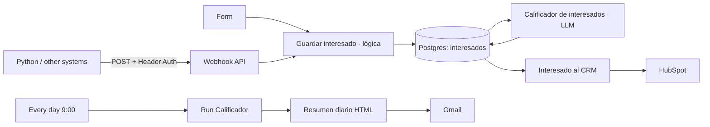

# Aula Norte · Automatizaciones

Automations for **Aula Norte**, a fictitious online school, built with **n8n**, **PostgreSQL (Supabase)**, **HubSpot**, **OpenAI** and **Python**.
Automatizaciones para **Aula Norte**, una escuela online ficticia.

## What it does



| Workflow | What it does |
|---|---|
| Guardar interesado · lógica | Sub-workflow. Validates the data, checks the course exists, saves the lead (upsert by email) and returns `{ok, id}` or `{ok, error}`. |
| Interesado · Form | Entry for people: n8n Form → logic → thank-you or error page. |
| Interesado · API | Entry for systems: Webhook (POST, Header Auth) → logic → HTTP 200 or 400 with JSON. |
| Interesado al CRM | Sends new leads to HubSpot and stores the CRM id. |
| Calificador de interesados | Classifies each lead as hot / warm / cold with an LLM (structured output + validation). Blocks prompt-injection attempts. |
| Evaluación calificador | 29 test cases. Accuracy went from 71% to 93%. |
| Resumen diario HTML | Every morning at 9: scores pending leads, then emails an HTML table of the last 24 h sorted by priority. Sends an email even with 0 leads. |

## Repository structure

- `workflows/` — n8n workflows (JSON). Credentials are not included, only their names.
- `sql/` — database schema and practice queries.
- `python/` — Colab notebook: lead-cleaning function with tests and calls to the API.
- `docs/` — notes.

## How to test

1. Create the tables with `sql/esquema.sql`.
2. Import the workflows in n8n (*Import from file*) and create your own credentials (Postgres, HubSpot, OpenAI, Gmail, Header Auth).
3. Send a lead to the API:

```python
requests.post(URL, json={"nombre": "Ana", "email": "ana@example.com",
                         "curso": "Excel avanzado", "mensaje": "¿Cuánto cuesta?"},
              headers={"X-Clave-Aula": KEY})
```

Expected: `200 {"ok": true, "id": ...}`. With an unknown course: `400 {"ok": false, "error": "curso no disponible"}`.

## Security and privacy

- No real personal data or secrets in this repo. Every file is reviewed in the pull request before merging.
- The API requires a header key. The LLM label never triggers an important action on its own.
